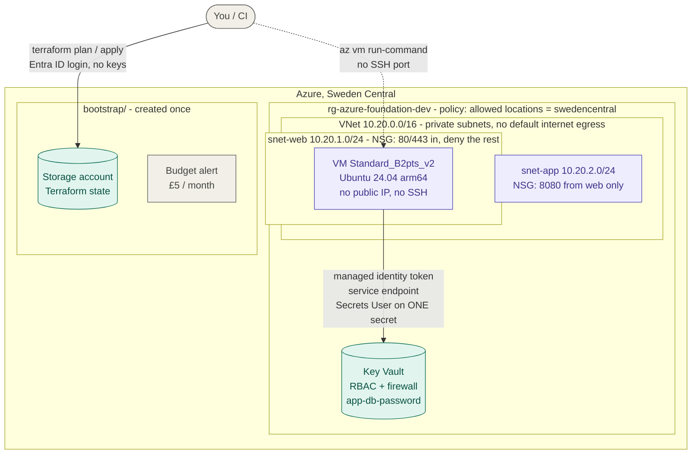

# terraform azure foundation

> A small, secure Azure foundation written as Terraform modules: remote state, a private network, an RBAC Key Vault and a VM that reads exactly one secret with its managed identity - guarded by Azure Policy, tested offline, and built entirely on the Azure free account.

[](https://gitlab.com/alex.iglesias7/terraform-azure-foundation/-/pipelines)
[](https://developer.hashicorp.com/terraform)
[](https://registry.terraform.io/providers/hashicorp/azurerm/latest)
[](#how-its-tested)
[](https://github.com/terraform-linters/tflint)
[](https://www.checkov.io/)
[-brightgreen)](#cost)
[](./LICENSE)

## What's in here

My earlier Terraform project, [terraform-freetier-localstack](https://github.com/alexiglesias/terraform-freetier-localstack), builds a web stack on AWS. This one builds the **same kind of foundation on Azure**, with the same layout and the same safety tooling, so the two can be compared side by side (see [Same design on AWS and Azure](#same-design-on-aws-and-azure)).

The goal is not a big application. It's the secure base that one would sit on:

1. **`bootstrap/`** creates, once, the storage account that holds Terraform's state, plus a monthly budget alert. HTTPS only, TLS 1.2, no public blob access, no storage account keys.
2. **`envs/dev`** is the environment. Its state was started locally and then **migrated** into that storage account. It creates a resource group with cost tags and calls three modules:
   - **`network`**: a VNet with two private subnets. The web subnet's firewall allows only 80 and 443.
   - **`keyvault`**: a Key Vault using Azure RBAC, behind a firewall, holding one secret that is **never written to Terraform state**.
   - **`compute`**: an Ubuntu VM with no public IP and no SSH, whose managed identity can read **that one secret and nothing else**.
3. An **Azure Policy** assignment refuses any resource outside the chosen region.

Everything goes through one `make` entry point, which checks you're signed in to the right subscription, shows the plan, and applies exactly what you approved.

## Requirements

> Everything here fits the **Azure free account** (see [Cost](#cost)). The tests, lint and security scan need no Azure account at all.

- [Terraform](https://developer.hashicorp.com/terraform/install) 1.16 - pinned in `.terraform-version` (works with `tfenv`). 1.11+ is required for write-only arguments.
- [Azure CLI](https://learn.microsoft.com/cli/azure/install-azure-cli), signed in with `az login`.
- For the quality checks: `brew install tflint checkov pre-commit shellcheck`.
- A region where the free VM sizes are open to your subscription. On this free-trial account that was **Sweden Central**, not UK South - check yours with:

  ```bash
  az vm list-skus -l swedencentral --resource-type virtualMachines --size Standard_B2ats_v2 --all -o table
  ```

## Architecture



How traffic and access are limited:

```
internet ──80/443──▶ nsg-web ──8080──▶ nsg-app        (everything else: deny-all at priority 4000)
VM ──service endpoint──▶ Key Vault                    (the subnets have no route to the internet)
VM identity ──Key Vault Secrets User──▶ app-db-password only
```

The VM has no public IP, so ports 80/443 are ready for a load balancer but nothing is reachable from the internet today. A load balancer or public IP would cost money, so it's deliberately left out.

## Quick start

**1. Bootstrap (once).** Creates the state storage account and the budget alert, and writes `envs/dev/backend.hcl` for you.

```bash
az login
cp bootstrap/terraform.tfvars.example bootstrap/terraform.tfvars   # subscription id + alert email
terraform -chdir=bootstrap init
terraform -chdir=bootstrap plan -out=bootstrap.tfplan
terraform -chdir=bootstrap apply bootstrap.tfplan
```

**2. The environment.**

```bash
cp envs/dev/terraform.tfvars.example envs/dev/terraform.tfvars    # subscription id, your IP, your object id, SSH public key
make plan        # read-only: shows exactly what would be created
make apply       # plan -> confirm -> apply that exact plan
```

**3. Prove the VM can read its secret - and only its secret.**

```bash
terraform -chdir=envs/dev output -raw read_secret_command   # prints the az vm run-command line to run
```

**4. Tear down.**

```bash
make destroy     # removes envs/dev; the state storage and budget stay (~£0)
```

## The make targets

| Target | What it does |
|---|---|
| `make plan` | Shows what would change, changes nothing |
| `make apply` | Plan → confirm → apply that exact saved plan. Refuses to run on the wrong subscription |
| `make destroy` | Plan destroy → confirm → apply that exact plan |
| `make output` | Shows the outputs: VM name, vault name, the secret-read command |
| `make check` | `terraform fmt` + `validate` on every root, offline |
| `make lint` | tflint, including the azurerm rules |
| `make security` | checkov security and leaked-secrets scan |
| `make test` | 13 module unit tests with mock providers, offline |
| `make ci` | Everything CI runs, in order |

The targets are thin wrappers around two scripts:

| Script | What it does |
|---|---|
| `scripts/tf.sh` | Runs plan/apply/destroy for one environment. Checks `az` is signed in to the subscription pinned in `terraform.tfvars`, shows the plan, asks you to type `yes` (or `destroy`), then applies the saved plan file. `--yes` or `CI=true` for pipelines |
| `scripts/read-secret.sh` | Runs **on the VM** via Run Command. Gets a token from the instance metadata service, reads the secret from Key Vault and prints only the HTTP status and the secret's length - never the value |

## Proof it works

Real output from the deployed environment.

**The VM reads its own secret** - no password or key anywhere, only its managed identity, from a subnet with no internet route:

```
$ az vm run-command invoke ... --scripts @scripts/read-secret.sh --parameters kv-azfdn-dev-ivxwkx app-db-password
Vault: kv-azfdn-dev-ivxwkx  Secret: app-db-password  HTTP 200
OK: secret read, length 24 characters (value not shown)
```

**...and is refused any other secret in the same vault** - least privilege:

```
$ az vm run-command invoke ... --parameters kv-azfdn-dev-ivxwkx other-secret
Vault: kv-azfdn-dev-ivxwkx  Secret: other-secret  HTTP 403
DENIED: Forbidden - Caller is not authorized to perform action on resource.
Action: 'Microsoft.KeyVault/vaults/secrets/getSecret/action'
Assignment: (not found)
```

**The state storage account is locked down** (asked from Azure, not from Terraform):

```
$ az storage account show -n stbe0d2ef973tfstate -g rg-azure-foundation-tfstate --query "{tls:minimumTlsVersion, httpsOnly:enableHttpsTrafficOnly, publicBlob:allowBlobPublicAccess, sharedKey:allowSharedKeyAccess}" -o table
Tls     HttpsOnly    PublicBlob    SharedKey
------  -----------  ------------  -----------
TLS1_2  True         False         False
```

**The secret's value is not in Terraform state** - it's sent with the write-only `value_wo` argument, so the stored `value` is empty (`terraform state pull` shows `"value": ""`); bumping `value_wo_version` rotates it:

```
$ terraform -chdir=envs/dev state show module.keyvault.azurerm_key_vault_secret.this | grep -i value
    value                   = (sensitive value)
    value_wo                = (write-only attribute)
    value_wo_version        = 1
```

**Azure Policy refuses anything outside Sweden Central** - Azure itself, not Terraform:

```
$ az network vnet create -g rg-azure-foundation-dev -n policy-test -l eastus
(RequestDisallowedByPolicy) Resource 'policy-test' was disallowed by policy.
Policy identifiers: '[{"policyAssignment":{"name":"Allowed locations: swedencentral only", ...},
                      "policyDefinition":{"name":"Allowed locations", ...}}]'
```

**Static checks:**

```
$ make security
Passed checks: 35, Failed checks: 0, Skipped checks: 11

$ make test
Success! 5 passed, 0 failed.   # compute
Success! 4 passed, 0 failed.   # keyvault
Success! 4 passed, 0 failed.   # network
```

### Secure defaults

- **No public IP, no SSH.** Admin access is `az vm run-command`, delivered by Azure's own agent channel. Password login is disabled.
- **Private subnets.** `default_outbound_access_enabled = false`: no hidden route to the internet. The VM reaches Key Vault through a free **service endpoint**, not a NAT gateway.
- **Deny-all NSG rule at priority 4000**, overriding Azure's default "allow everything inside the VNet", so 80/443 really are the only open ports on the web tier.
- **Managed identity, least privilege.** The VM's identity has *Key Vault Secrets User* on **one secret**, not on the vault.
- **Secrets never touch state.** The password is an *ephemeral* `random_password` sent with the *write-only* `value_wo` argument. It isn't in the plan file or the state.
- **RBAC Key Vault behind a firewall**: default deny, allowing only one admin IP and the web subnet.
- **Hardened state storage**: TLS 1.2, HTTPS only, no public blob access, **account keys disabled** (Entra ID login only), local users off, infrastructure encryption, versioning, 7-day soft delete, `prevent_destroy`.
- **Azure Policy guardrail**: the built-in *Allowed locations* policy on the resource group, so Azure itself rejects resources outside Sweden Central.
- **Trusted Launch** (secure boot + vTPM) on x64 VM sizes.
- **Only free VM sizes accepted.** A validation rejects anything except `Standard_B2ats_v2`, `Standard_B2pts_v2` and `Standard_B1s`, and the OS disk is capped at 64 GB.

## Cost

Built for the Azure free account (12-month free services + 30-day credit):

| Resource | Free allowance used | Cost |
|---|---|---|
| VM `Standard_B2pts_v2` (Arm) | 750 hours/month for 12 months | £0 |
| OS disk, Premium SSD 64 GB (P6) | 2 × P6 for 12 months | £0 |
| State storage account (LRS, a few KB) | 5 GB LRS blob for 12 months | £0 |
| VNet, subnets, NSGs, service endpoint, NIC | Always free | £0 |
| Azure Policy assignment | Always free for Azure resources | £0 |
| Key Vault (standard) | A few hundred operations at $0.03 per 10,000 | < £0.01 |
| Budget alert | Free | £0 |
| **Deliberately not used** | Public IPs, Azure Bastion, NAT gateway, private endpoints, Log Analytics | - |

A budget in `bootstrap/` emails at 80% and 100% of £5/month and on the forecast. It lives outside `envs/dev`, so it keeps watching after `make destroy`. After the 30-day free trial the account moves to pay-as-you-go, which has no spending cap - the budget is the alarm.

## Same design on AWS and Azure

| Concern | AWS ([terraform-freetier-localstack](https://github.com/alexiglesias/terraform-freetier-localstack)) | Azure (this repo) |
|---|---|---|
| Remote state | S3 bucket, `use_lockfile` | Blob container, lease lock, Entra ID auth (keys off) |
| One-time setup | `bootstrap/` with local state | `bootstrap/` with local state |
| Grouping | Tags (and accounts) | Resource group + tags |
| Network | VPC, public/private subnets | VNet, private subnets (no default egress) |
| Firewall | Security groups (per ENI, stateful) | NSGs (per subnet, priority-ordered rules) |
| Admin access without SSH | SSM Session Manager | Run Command |
| Machine identity | IAM role + instance profile | System-assigned managed identity |
| Secret store | Secrets Manager (password generated by RDS) | Key Vault with RBAC (password via ephemeral + write-only) |
| Least privilege on one secret | IAM policy on one secret ARN | Role assignment scoped to one secret |
| Guardrail | SCP / AWS Config | Azure Policy assignment |
| Wrong-account guard | `allowed_account_ids` | `subscription_id` + `tf.sh` check against `az account show` |
| Budget | AWS Budgets | Cost Management budget |
| Free VM | t3.micro (credit-based Free plan) | B2pts_v2 / B2ats_v2, 750 h/month |

## How it's tested

- **`make test`** runs 13 `terraform test` unit tests with mock providers: no Azure login, no cost. They check the promises the design depends on - private subnets, the Key Vault service endpoint, only 80/443 open on web, the app tier reachable only from web, RBAC and default-deny on the vault, a write-only secret, no public IP, the free P6 disk, the one-secret role scope, the arm64 image on Arm sizes - and that bad input is rejected (a billed VM size, a non-public SSH key, a too-long vault name, an IP without `/32`).
- **tflint** with the azurerm ruleset, and **checkov** for misconfigurations and leaked secrets. checkov reports **0 failed checks**. The 11 accepted findings are skipped inline, next to the resource, each with its reason: features that cost money (private endpoints, customer-managed keys, geo-replication, storage logging), access the laptop and CI need, purge protection (it would block `make destroy`), the Run Command agent, and port 80 on the web tier.
- **GitLab CI** (`.gitlab-ci.yml`) runs fmt, validate, tflint, checkov and the unit tests on every merge request and on `main`. The pipeline has no cloud credentials at all; `main` only accepts merge requests with a green pipeline.
- **pre-commit** runs fmt, validate, tflint, shellcheck and private-key detection on every commit.
- **In Azure**, the whole environment was deployed and verified with the commands in [Proof it works](#proof-it-works).

## Troubleshooting

| Symptom | Likely cause |
|---|---|
| `az vm list-skus` shows `NotAvailableForSubscription` | Free-trial subscriptions are blocked from some regions (UK South here). Pick a region where the size has no restrictions |
| `AllocationFailed ... sufficient capacity` | Azure is temporarily out of that size. Set `vm_size = "Standard_B2pts_v2"` (Arm, also free) or retry later. Don't accept the suggested `Standard_B2ts_v2`: it isn't free |
| VM create failed and now "already exists" | A failed create can leave a VM and its OS disk in Azure that Terraform doesn't track. Delete both with `az vm delete` and `az disk delete`, then apply again |
| `403` writing the secret on the first apply | Role assignments take minutes to propagate. The module waits 90 s; if it still fails, apply again |
| `403` from `terraform init` on the backend | Your *Storage Blob Data Contributor* role from the bootstrap hasn't propagated yet. Wait a few minutes |
| `403` from the Key Vault on `plan` | Your public IP changed. Update `allowed_ip_addresses` (with `/32`) |
| `az is on subscription X, but terraform.tfvars pins Y` | `az account set -s <id>` - the guard stopped Terraform before it touched the wrong subscription |
| `az vm list-skus` seems to hang | It downloads Azure's whole catalogue; give it a couple of minutes |
| `NetworkWatcherRG` appeared | Azure creates it automatically with the first VNet in a region. It's free |
| `No ephemeral resource types in mock providers` in tests | Mock providers can't fake ephemeral resources yet, so the keyvault test uses the real (local, free) `random` provider |

## Project structure

```
terraform-azure-foundation/
├── bootstrap/                  # one-time: state storage account + budget alert (local state)
├── envs/
│   └── dev/                    # the environment: azurerm backend, resource group, policy, module calls
├── modules/
│   ├── network/                # VNet, private subnets, NSGs (80/443 to web only)
│   ├── keyvault/               # RBAC Key Vault, firewall, write-only secret
│   └── compute/                # VM, managed identity, role on one secret
│       └── tests/              # every module has terraform test files
├── scripts/
│   ├── tf.sh                   # plan / apply / destroy with confirmation + subscription guard
│   └── read-secret.sh          # runs on the VM: proves the identity can read its secret
├── .gitlab-ci.yml              # CI: fmt, validate, tflint, checkov, tests on every MR
├── Makefile                    # run `make` to list every target
├── .tflint.hcl  .checkov.yaml  .pre-commit-config.yaml
└── .terraform-version          # pinned Terraform version
```

## License

[MIT](./LICENSE)
